# Esquemas de plantación, desde arriba

Sale de `tests/plantacion.gd --salida` (vista.gd `plaza_rejilla` y `tresbolillo`). 2 px por cm; abajo, en rojo, el lado de delante (el que se ve en la vista C); en gris, la rejilla de antes; en verde, las macetas. La carpa de 400 × 400 se ve por mitades: la del fondo, arriba.

| Esquema | Maceta | Plazas | Rejilla (por mitad) | Disposición | Plano |
|---|---|---|---|---|---|
| casa-p60-plastico7 | plastico7 | 2 | 2 × 1 | una fila |  |
| casa-p60-tela11 | tela11 | 2 | 2 × 1 | una fila | 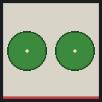 |
| casa-p80-plastico7 | plastico7 | 3 | 2 × 2 | las filas ya caen entre las de al lado | 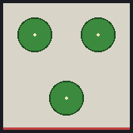 |
| casa-p80-tela11 | tela11 | 3 | 2 × 2 | las filas ya caen entre las de al lado | 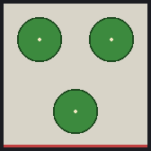 |
| casa-p80-plastico18 | plastico18 | 3 | 2 × 2 | las filas ya caen entre las de al lado | 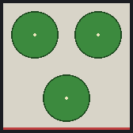 |
| casa-m100-plastico7 | plastico7 | 4 | 2 × 2 | tresbolillo, las de detrás a 24 cm de las de delante | 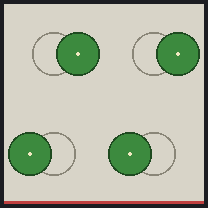 |
| casa-m100-tela11 | tela11 | 4 | 2 × 2 | tresbolillo, las de detrás a 21 cm de las de delante | 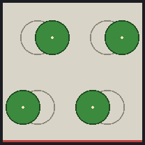 |
| casa-m100-plastico18 | plastico18 | 4 | 2 × 2 | tresbolillo, las de detrás a 16 cm de las de delante | 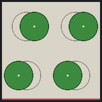 |
| casa-m100-tela25 | tela25 | 4 | 2 × 2 | tresbolillo, las de detrás a 11 cm de las de delante | 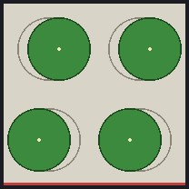 |
| casa-m120-plastico7 | plastico7 | 6 | 3 × 2 | tresbolillo, las de detrás a 14 cm de las de delante | 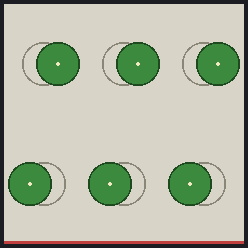 |
| casa-m120-tela11 | tela11 | 6 | 3 × 2 | tresbolillo, las de detrás a 11 cm de las de delante | 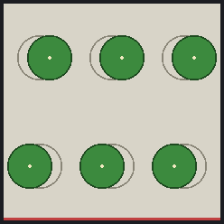 |
| casa-m120-plastico18 | plastico18 | 6 | 3 × 2 | tresbolillo, las de detrás a 6 cm de las de delante | 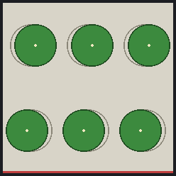 |
| casa-m120-tela25 | tela25 | 6 | 3 × 2 | sin tresbolillo: la maceta no deja | 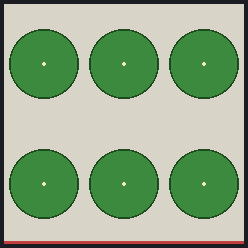 |
| casa-g150-plastico7 | plastico7 | 6 | 3 × 2 | tresbolillo, las de detrás a 24 cm de las de delante | 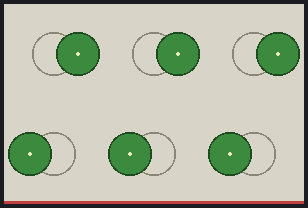 |
| casa-g150-tela11 | tela11 | 6 | 3 × 2 | tresbolillo, las de detrás a 21 cm de las de delante | 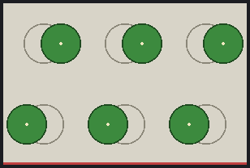 |
| casa-g150-plastico18 | plastico18 | 6 | 3 × 2 | tresbolillo, las de detrás a 16 cm de las de delante | 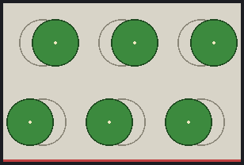 |
| casa-g150-tela25 | tela25 | 6 | 3 × 2 | tresbolillo, las de detrás a 11 cm de las de delante | 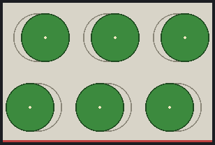 |
| casa-g150-tela35 | tela35 | 6 | 3 × 2 | tresbolillo, las de detrás a 6 cm de las de delante | 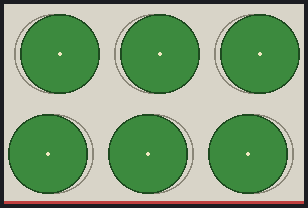 |
| kaia-s-tela35-4 | tela35 | 4 | 2 × 2 | tresbolillo, las de detrás a 50 cm de las de delante | 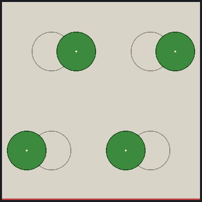 |
| kaia-s-tela25-16 | tela25 | 16 | 4 × 4 | tresbolillo, las de detrás a 11 cm de las de delante | 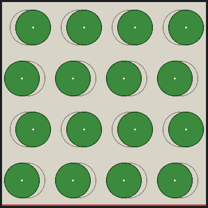 |
| kaia-s-tela35-9 | tela35 | 9 | 3 × 3 | tresbolillo, las de detrás a 23 cm de las de delante | 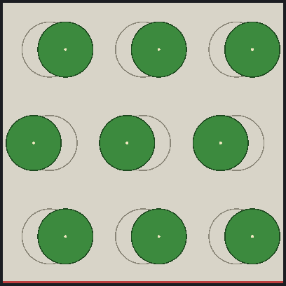 |
| kaia-s-tela50-4 | tela50 | 4 | 2 × 2 | tresbolillo, las de detrás a 50 cm de las de delante | 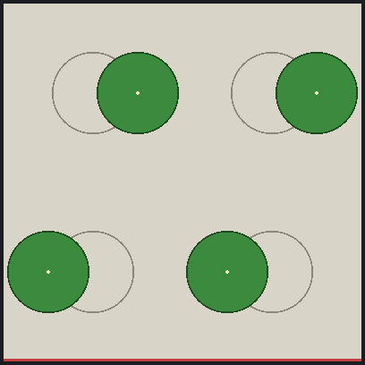 |
| kaia-m-tela35-8 | tela35 | 8 | 4 × 2 | tresbolillo, las de detrás a 50 cm de las de delante | 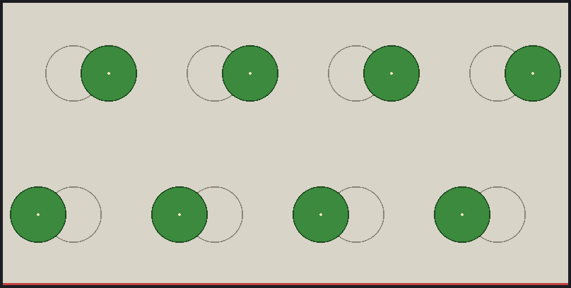 |
| kaia-m-tela25-32 | tela25 | 32 | 8 × 4 | tresbolillo, las de detrás a 11 cm de las de delante | 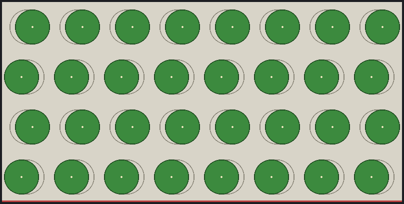 |
| kaia-m-tela35-18 | tela35 | 18 | 6 × 3 | tresbolillo, las de detrás a 23 cm de las de delante | 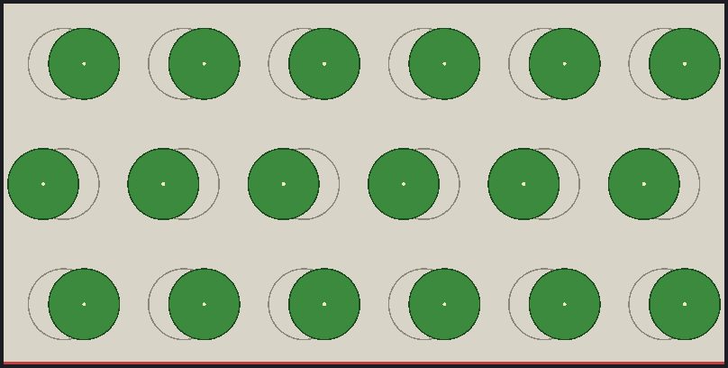 |
| kaia-m-tela50-8 | tela50 | 8 | 4 × 2 | tresbolillo, las de detrás a 50 cm de las de delante | 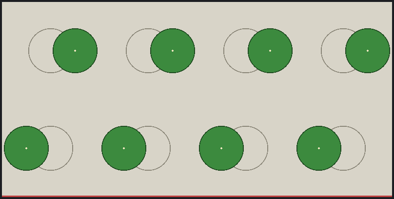 |
| kaia-l-tela35-16 | tela35 | 16 | 4 × 2 | tresbolillo, las de detrás a 50 cm de las de delante | 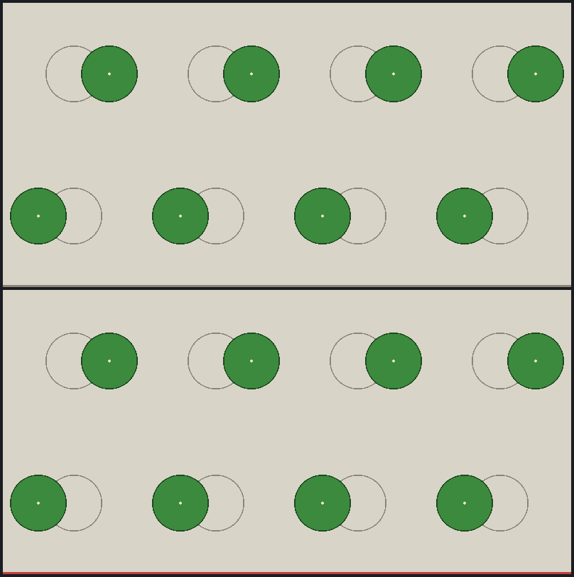 |
| kaia-l-tela25-64 | tela25 | 64 | 8 × 4 | tresbolillo, las de detrás a 11 cm de las de delante | 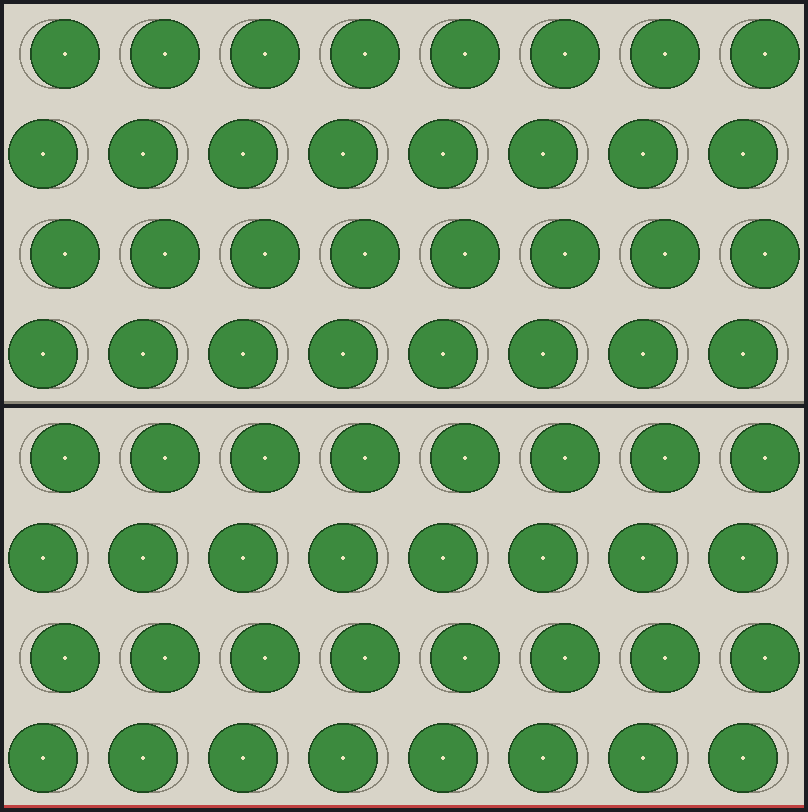 |
| kaia-l-tela35-36 | tela35 | 36 | 6 × 3 | tresbolillo, las de detrás a 23 cm de las de delante | 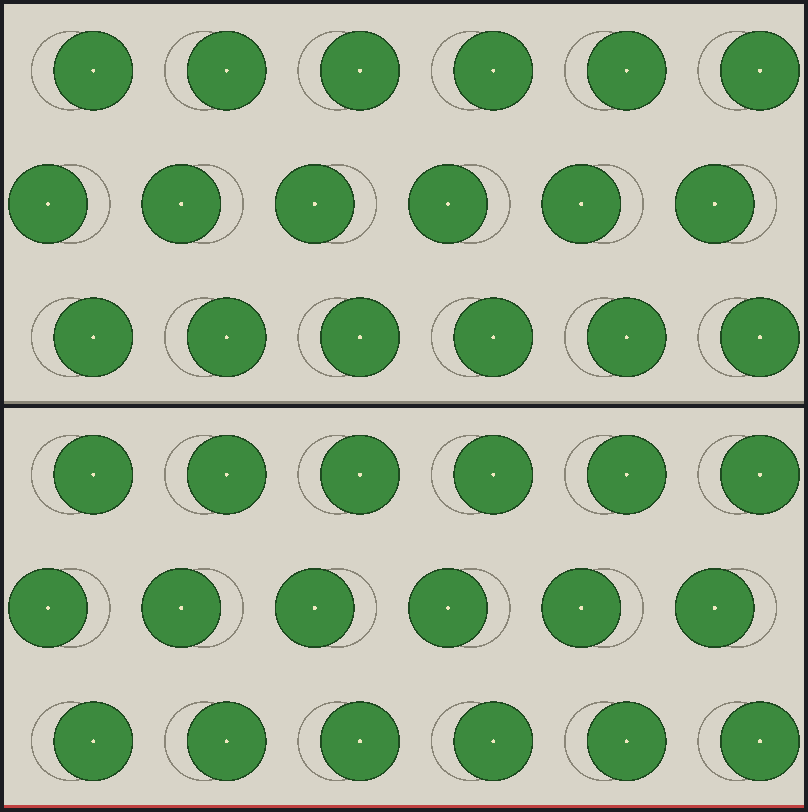 |
| kaia-l-tela50-16 | tela50 | 16 | 4 × 2 | tresbolillo, las de detrás a 50 cm de las de delante | 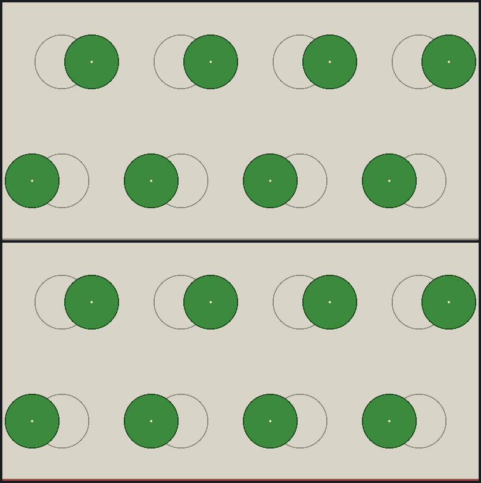 |
